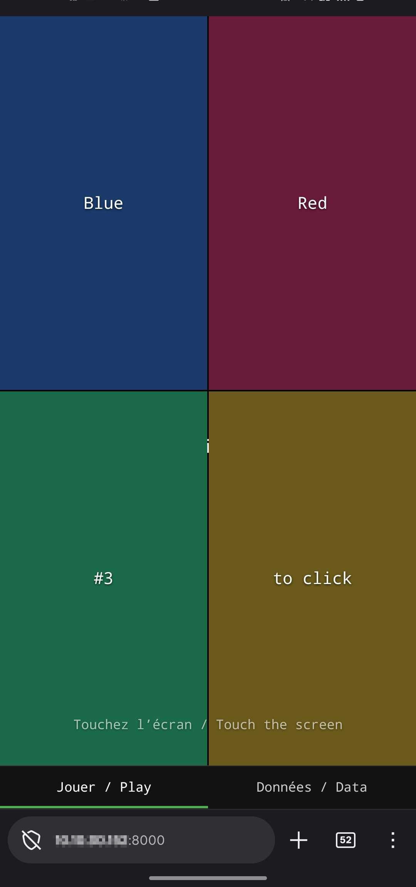
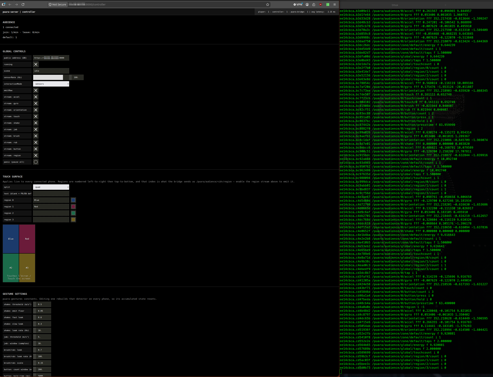

# puara-server

[](https://github.com/Puara/puara-server/actions/workflows/install.yml)

Browser-based audience interaction system for the
[Satosphère](https://sat.qc.ca/) — the SAT's 18 m immersive dome.

Audience members scan a QR code, open a web page on their phone, tap
**Commencer / Start**, and their device becomes a sensor/controller for the
piece: accelerometer, gyroscope, orientation, touch, taps and shakes stream to
the show system as OSC under a [Puara](https://github.com/Puara)-compatible
namespace, consumed by [ossia score](https://ossia.io/) and onward by
[SpatGRIS](https://gris.musique.umontreal.ca/)/MBAP or any OSC-capable tool.

This repository is **reusable infrastructure**, not a one-off piece: residency
artists configure interaction modes, zones, rates and OSC destinations in one
YAML file ([`config/puara.yaml`](config/puara.yaml)) without touching
framework internals.

The bridge can also run the real C++
[puara-gestures](https://github.com/Puara/puara-gestures) descriptors next to
the JS ports the phones compute — same input, both implementations, under
`/puara/gestures/…` and `/puara/audience/…` — through an optional Node addon
built from a checkout of that library. Without it, everything else runs as
usual. See [docs/GESTURE-TESTER.md](docs/GESTURE-TESTER.md).

## Screenshots



The player, on an audience phone: a `quad` touch surface designed from the
dashboard — per-region label and colour, bilingual headline — and the
*Jouer / Play* · *Données / Data* tabs, the second of which shows the device
its own outgoing values.



The controller dashboard (left) and `oscdump` of what reaches ossia score
(right): audience counts and join/leave rate, global controls with per-stream
toggles and panic, the touch-surface designer with its live preview, and the
puara-gestures constants — all editable while the piece runs.

## Architecture

```
[phone browsers]  --wss-->  [soundworks server (Node.js)]  <--ws-->  [controller dashboard (browser)]
                                      |
                                      v (SharedState observation)
                            [puara-bridge (soundworks Node client)]
                                      |
                                      v UDP OSC
                              [ossia score]  -->  [SpatGRIS / MBAP / piece logic]
```

Three client roles, one server:

| role | runtime | purpose |
|---|---|---|
| `player` | browser (phone) | sensors + touch UI → shared state; bilingual FR/EN, wake lock, zone from QR `?zone=…` |
| `controller` | browser | operator dashboard: live counts, per-client meters, sensor rate / interaction mode / scene controls, panic, per-zone QR codes (printable) |
| `puara-bridge` | node (headless) | observes all player states, computes crowd aggregates at a fixed tick, emits OSC |

## Built on soundworks (IRCAM)

The networking, state and client lifecycle layer is
[**soundworks**](https://soundworks.dev/), an open-source (BSD-3-Clause)
creative-coding framework for distributed WebAudio/web applications, developed
by the [{Sound Music Movement} Interaction team (ISMM)](https://ismm.ircam.fr/)
at IRCAM (STMS-LAB, Paris). soundworks was designed exactly for this class of
piece — *collaborative mobile web performances* where dozens to hundreds of
phones join a shared, synchronized environment.

What soundworks provides here:

- **Distributed shared state** (`StateManager`): each phone owns a `player`
  state; the server, dashboard and bridge observe collections of them. A
  dashboard change to the server-owned `global` state (e.g. `sensorRate`)
  propagates to every phone in well under a second — no hand-rolled protocol.
- **Client lifecycle & reconnection**: init screens, automatic WebSocket
  reconnection after lock/unlock or WiFi blips, browser *and* Node.js clients
  from the same codebase (the OSC bridge is just a headless soundworks client).
- **Plugins**: [`platform-init`](https://soundworks.dev/plugins/platform-init.html)
  (iOS motion-permission flow inside the required user gesture, via
  [`@ircam/devicemotion`](https://github.com/ircam-ismm/devicemotion) which
  normalizes iOS/Android sensor conventions) and
  [`checkin`](https://soundworks.dev/plugins/checkin.html) (unique client ids).
- **Tooling**: [`@soundworks/create`](https://github.com/collective-soundworks/soundworks-create)
  scaffolding, build pipeline, and [`@ircam/sc-components`](https://ircam-ismm.github.io/sc-components/)
  web components used by the dashboard.

References:

- Documentation & tutorials: <https://soundworks.dev/>
- API reference: <https://soundworks.dev/api>
- Source: <https://github.com/collective-soundworks/soundworks>
- ISMM team at IRCAM: <https://ismm.ircam.fr/>
- Founding paper: S. Robaszkiewicz & N. Schnell, *“Soundworks – A playground
  for artists and developers to create collaborative mobile web performances”*,
  Proceedings of the 1st Web Audio Conference (WAC), Paris, 2015.

The OSC vocabulary follows the conventions of the SAT's own
[**Puara**](https://github.com/Puara) framework for new media instruments and
installations; the full contract lives in [`docs/NAMESPACE.md`](docs/NAMESPACE.md).

## Getting started

Two scripts cover a workstation or show machine end to end, on Linux, macOS
and Windows. No sudo or administrator rights. The only prerequisite is
[Node.js](https://nodejs.org) ≥ 18 (the LTS installer is fine).

Linux and macOS:

```sh
./scripts/install.sh     # dependencies, mkcert, LAN certificate, env, build
./scripts/start.sh       # soundworks server + OSC bridge, Ctrl-C stops both
```

Windows (Command Prompt or PowerShell, from the repo folder):

```bat
scripts\install.cmd
scripts\start.cmd
```

The `.cmd` files run `scripts\install.ps1` / `scripts\start.ps1` without
changing the machine's PowerShell execution policy. Windows options are
PowerShell-style: `-NoHttps`, `-Env default`, `-NoBridge`, `-Dump`, `-ServeCa`.

The install scripts are **safe to rerun**: each step checks its own result and skips.
What they do: verify Node ≥ 18 · `npm ci` (the exact versions in
`package-lock.json`) · fetch mkcert (checksum-pinned) to `~/.local/bin`, or
`%LOCALAPPDATA%\puara-server\bin` on Windows, if missing · write
`config/env-dev.yaml` if it does not exist · issue a certificate in `certs/`
for the detected LAN IP, hostname and localhost · build the C++ addon if they
can · build. Use `--no-https` (`-NoHttps` on Windows) for a desktop-only setup
(no phone sensors).

**Another network or another machine needs no setup — just start.** Every
start checks the certificate (`scripts/https.mjs`) and reissues it when it
does not cover the machine's current LAN address (or the host in
`publicAddress`), expires within 30 days, or was signed by another machine's
CA. It is always signed by this machine's mkcert CA, so phones that trust that
CA keep working. On a different machine, phones must install its CA once
(`--serve-ca`) — or copy the `mkcert -CAROOT` folder over before installing,
and they won't need to. `serverAddress` stays blank, so phones connect back to
the address they opened the page from, and the QR codes use the LAN address
found at start: after a network change, restart. The scripts own `certs/`; a
certificate you keep elsewhere is checked, never replaced.

Per-OS notes:

- **macOS** — the addon needs the Xcode command line tools
  (`xcode-select --install`). If the firewall is on, allow incoming
  connections for `node` when asked.
- **Windows** — the addon needs Visual Studio Build Tools with *Desktop
  development with C++* and Python 3 (the Node.js installer's *Tools for Native
  Modules* option installs both). Windows Firewall asks about Node.js on first
  start: allow it on **Private** networks, and set the venue network's profile
  to Private. `combine-gestures-prs.sh` runs in Git Bash. `-Dump` needs
  `oscdump` (liblo) on the PATH, which Windows rarely has — use ossia score or
  the dashboard instead.
- On all three the addon is optional: without it the server and bridge run,
  minus `/puara/gestures`.

Dependency versions are pinned by the committed `package-lock.json`. To move
them, run `npm install <pkg>@<version>` (or `npm update`), test, and commit the
lockfile with it.

`start.sh` flags (`start.cmd` equivalents in brackets):

| flag | effect |
|---|---|
| *(none)* | `ENV=dev` (HTTPS) if `config/env-dev.yaml` exists, else `default` (HTTP) |
| `--env <name>` (`-Env <name>`) | pick `config/env-<name>.yaml` explicitly |
| `--no-bridge` (`-NoBridge`) | server only |
| `--dump` (`-Dump`) | also run `oscdump` on the first configured OSC port |
| `--serve-ca` (`-ServeCa`) | serve the mkcert root CA over HTTP :8001 so a phone can install it |

Manual equivalent, if you prefer separate terminals:

```sh
npm ci
npm run dev        # build + watch, server on http://127.0.0.1:8000
npm run bridge     # in a second terminal: OSC bridge (after `npm run build`)
```

- Player (phones): `https://<server-ip>:8000/?zone=north`
- Controller dashboard: `https://<server-ip>:8000/controller`
- OSC out: UDP `127.0.0.1:9000` by default — verify with
  `oscdump 9000` or point ossia score at it. Only one process can bind that
  port: add a second entry to `oscDestinations` to feed a monitor and ossia at
  the same time.
- Emulate a crowd without phones: `http://127.0.0.1:8000/?emulate=10`.

### Connecting a real phone

1. `./scripts/install.sh`, then `./scripts/start.sh` (Windows:
   `scripts\install.cmd`, then `scripts\start.cmd`).
2. `./scripts/start.sh --serve-ca` (`scripts\start.cmd -ServeCa`) in another terminal, open that URL on the
   phone, install the CA. On iOS also enable it under Settings → General →
   About → Certificate Trust Settings — the install alone is not enough, and
   without it `wss://` fails silently while the page still loads. Stop serving
   once enrolled.
3. Open the player URL, tap **Commencer / Start** — that gesture is what
   triggers the iOS motion permission prompt.
4. On the dashboard, click the red **STOPPED** button at the top so it turns
   green (**RUNNING**). Sensors are gated on it.

Installing a local CA on a phone means whoever holds the CA private key
(`$(mkcert -CAROOT)/rootCA-key.pem`, on the server) can impersonate any HTTPS
site to that device. Use your own test hardware, keep the key on the machine
that generated it, and remove the CA from the phone when testing is over.
Audience devices must never install it — that is what the Let's Encrypt path in
[`docs/DEPLOYMENT.md`](docs/DEPLOYMENT.md) is for.

## HTTPS & certificates

**Real phones require HTTPS**: browsers only expose the motion sensors and
wake lock in a secure context, and on iOS a page-level certificate exception
does *not* cover `wss://` — so a properly trusted certificate is not optional.
[`docs/DEPLOYMENT.md`](docs/DEPLOYMENT.md) covers the whole topic:

- **dev/lab**: [mkcert](https://github.com/FiloSottile/mkcert) local CA,
  installed once on each test phone;
- **production/audience**: a real hostname (e.g. `connect.sat.qc.ca`) with a
  free Let's Encrypt certificate obtained via DNS-01 challenge — including the
  concrete Cloudflare + certbot recipe, renewal, and why the server never
  needs to be exposed to the internet;
- the audience-scale WiFi checklist for the venue network team.

## Configuration (artist-facing)

Everything tunable lives in [`config/puara.yaml`](config/puara.yaml):
`sensorRate` (ceiling, Hz), `bridgeTick` (aggregate/OSC tick, Hz), `emitRaw`
(per-device raw streams on/off), `interactionMode`
(`sensors` / `touch` / `events-only`), `zones` (dome sections → QR codes),
`streams` (per-stream enable for accel/gyro/orientation/touch and each gesture
descriptor — gates the phone uplink, not just the OSC output), `publicAddress`
(origin the QR codes point at), `maxTouches`, `touch` (touch surface design,
regions or a plugin surface such as the gamepad — see below), `gestures` (puara-gestures constants), `maxClients`,
`oscDestinations`. Everything except
`bridgeTick`/`maxClients`/`oscDestinations` can also be changed **live** from
the controller dashboard.

### Gestures

Phones compute the [puara-gestures](https://github.com/Puara/puara-gestures)
descriptors locally ([`src/shared/gestures.js`](src/shared/gestures.js)) and
send those, so the network carries gestures rather than the motion behind them:

| descriptor | OSC | behaviour |
|---|---|---|
| `shake` | `fff` | energy per axis, accumulates while shaking, decays to 0 |
| `jab` | `fff` | signed acceleration span, latches on the last hit |
| `brush` | `ff` | signed touch travel per screen axis |
| `rub` | `ff` | unsigned, so back-and-forth accumulates |
| `button` | see below | `count`/`tap`/`dtap`/`ttap`/`press`/`hold`/`presstime` |

Multi-touch is on: `touch/count` plus `touch/<n>` per pointer, up to
`maxTouches`. Every constant is editable live in the dashboard's *Gesture
settings* panel — thresholds, leak rates, tap window, hold time. Full contract
in [`docs/NAMESPACE.md`](docs/NAMESPACE.md).

**Upgrading from namespace 0.1.0:** `/shake` was an event float on a threshold
crossing; that measurement is now `/jab fff` and `/shake fff` is the continuous
energy signal. Patches listening for the old `/shake f` should move to `/jab`.

### Touch surface

What the audience sees and touches is designed in the dashboard's *Touch
surface* panel, live on every connected phone, and seeded from the `touch` block
of `config/puara.yaml`:

- **split** — `single`, `columns` (left | right), `rows` (top / bottom) or
  `quad` (2×2).
- **text** — the headline across the surface. Blank keeps the built-in bilingual
  *Touchez l'écran / Touch the screen*; your own text replaces it in both
  languages, so write it bilingual.
- **per-region label and colour** — one of each per sub-area. Keep colours dark:
  a few hundred bright phone screens light the dome from the seats.
- **touch feedback** — on by default. A ring appears under each finger, and
  brightens once the payload carrying that touch has actually left the phone, so
  the confirmation means *you are in the show*, not merely *the glass registered
  a press*: a phone with every stream switched off shows contact and never
  brightens. The pressed region dims at the same time. Built to subtract light
  rather than add it — hairline ring, region darker — but switch it off for a cue
  that needs the seats completely dark.

Regions are numbered left-to-right then top-to-bottom, and that index reaches
OSC as `/puara/audience/<id>/region` (`-1` on release) plus a per-region audience
count on `/puara/audience/global/region/<n>/count`. Both are gated by
`streams.region`, so a piece can consume "which panel" with raw `touch`
switched off. Geometry and region math are shared by the dashboard preview, the
phones and the bridge in
[`src/shared/touch-layout.js`](src/shared/touch-layout.js).

Audience members can check what their own phone is sending in the player's
*Données / Data* tab, which ends in a miniature of the surface — same split,
same colours, same region indices. Touching it feeds the real handlers, so the
values above it move while a finger is on it, which is the only way to watch
`touch`, `brush`/`rub`, `button` and `region` respond to a known gesture. It
sends for real, and it is only offered while the show is running.

### Touch surfaces: regions, gamepad, your own

What the phone draws is chosen live in the dashboard's *Touch surface* panel
(**surface**), or with `touch.surface` in `config/puara.yaml`:

- **`regions`** (built in) — the coloured split described above.
- **`gamepad`** — a game controller, modelled on an emulator's touchscreen
  overlay (DuckStation's): d-pad and face buttons under the thumbs, two
  analogue sticks, L1/L2/R1/R2 at the top, Select/Start in the middle.
- **`xy-pad`** — one big pad: the finger's position and whether it is down. The
  smallest complete example, meant to be copied.
- **anything in `surfaces/local/`** — your own. Every surface except the
  regions is one JavaScript file in [`surfaces/`](surfaces/); drop a new one
  in `surfaces/local/` (ignored by git) and it appears in the dropdown as soon
  as it is saved — no restart, no build. Each file declares its own dashboard
  controls and its own OSC outputs. Step-by-step tutorial:
  **[docs/CUSTOM-SURFACES.md](docs/CUSTOM-SURFACES.md)**; reference:
  [surfaces/README.md](surfaces/README.md).

What every surface shares:

- **The touch data does not change.** `touch`, `touch/<n>`, `tap`,
  `brush`/`rub`, `button` and `region` are computed from the same pointers
  whatever is drawn (`region` keeps following the split last chosen for the
  regions, invisibly; the dashboard hides the split and region editors while
  another surface is shown).
- **A plugin surface adds its own outputs**, under `streams.surface`:
  `/puara/audience/<id>/<surface>/<output>` per phone, and
  `/puara/audience/global/<surface>/<output>/count` (phones holding a button)
  or `/puara/audience/global/<surface>/<output>` (mean of a value) for the
  audience, while that surface is drawn. The dashboard lists each surface's
  addresses under its controls.
- A phone that drops out mid-press, changes tab or switches surface sends the
  releases, so nothing downstream is left held.
- The Data tab's pad draws the same surface, and a row named after the surface
  shows what it is sending.

The gamepad in detail ([`surfaces/gamepad.js`](surfaces/gamepad.js)):

- `/puara/audience/<id>/gamepad/<button> i` (`1` press, `0` release) for
  `south east west north l1 r1 l2 r2 select start dpad/up dpad/down dpad/left
  dpad/right`, and `/puara/audience/<id>/gamepad/stick/left|right ff` in
  −1..1 — the same addresses as before surfaces were plugins.
- **gamepad style** — `playstation` (✕ ○ □ △, L1/R1) or `xbox` (A B X Y, LB/RB).
  Look only: OSC names are positional (`south` is ✕ *and* A), so a patch
  survives the switch.
- Portrait or landscape, whichever way the phone is held; the layout and the
  hit test share one geometry, so the button reported is the one drawn under
  the finger.
- The d-pad and face buttons are drawn as large as the screen allows, and both
  are read by direction from their centre: the whole diamond of face buttons is
  the target, so a thumb landing between two buttons presses the nearer one
  instead of nothing, and they can be played without looking.
- Fingers slide from button to button without lifting; a thumb between two face
  buttons presses both, and between two d-pad arms gives the diagonal. A stick
  is grabbed from a little outside its base and held until the finger lifts.

**Upgrading from namespace 0.5.0:** the gamepad's addresses are unchanged. In
`config/puara.yaml`, `streams.gamepad` is now `streams.surface` and
`touch.gamepadStyle` is now `touch.surfaces.gamepad.style`; the old keys are
still read.

**Upgrading from namespace 0.3.0:** touch coordinates are now normalized against
the touch surface rather than the viewport, so `y = 1` is the bottom of the area
the audience can actually touch. Previously `y` was biased low by the height of
the tab bar and horizontal seams sat half a tab bar below where the phone draws
them. A patch that hard-codes a `y` threshold instead of reading `region` should
be re-checked.

### QR code address

QR codes point at `publicAddress`, never the dashboard's own URL — an operator
with the dashboard open on `localhost` would otherwise print QR codes no phone
can reach. Leave it blank and the server uses its own LAN address; set it to a
hostname (`https://connect.sat.qc.ca:8000`) when one points at the machine. The
dashboard has an editable field for it and regenerates the codes on change.

Environment config (port, HTTPS certs) follows the soundworks convention:
`config/env-default.yaml`, overridden by `ENV=<name>` →
`config/env-<name>.yaml` (gitignored except default).

## Repository layout

```
src/
├── server.js                 # server, plugins, state classes, global state
├── clients/
│   ├── player.js             # audience phone client
│   ├── controller.js         # operator dashboard
│   └── puara-bridge.js       # headless client → UDP OSC
└── shared/
    ├── schemas.js            # SharedState class descriptions
    ├── namespace.js          # OSC namespace builder (single source of truth)
    ├── touch-layout.js       # region split geometry
    ├── surfaces.js           # the surface plugin contract (params, outputs, wire format)
    ├── surface-host.js       # loads a surface in the browser (player + dashboard)
    ├── load-surfaces.js      # scans surfaces/ and surfaces/local/ (server side)
    ├── strings.js            # FR/EN UI strings
    └── load-puara-config.js  # config/puara.yaml loader (node side)
surfaces/                     # touch surface plugins — guide in surfaces/README.md
├── gamepad.js                # the virtual gamepad (+ gamepad/: geometry, view, css)
├── xy-pad.js                 # the smallest complete example
└── local/                    # your own surfaces, ignored by git
native/                       # optional: the puara-gestures C++ addon
├── binding.gyp               # C++20 build against a puara-gestures checkout
├── gestures-path.cjs         # where that checkout is
└── src/puara_addon.cpp       # one descriptor bank per phone
docs/
├── NAMESPACE.md              # the OSC contract (versioned, currently 0.6.0)
├── CUSTOM-SURFACES.md        # tutorial: making your own touch surface
├── GESTURE-TESTER.md         # running the C++ library live (the addon)
├── DEPLOYMENT.md             # certs, DNS, WiFi notes
└── images/                   # README screenshots
```

## Status & roadmap

Prototype (M1–M2 of the project brief): skeleton + bridge verified end-to-end
on LAN. Remaining: dashboard hardening (M3), aggregate tuning with a 5-phone
demo driving an ossia scenario (M4), frozen namespace + artist guide (M5).
Explicit non-goals for v1: phone audio playback, puara-gestures descriptor
extraction (raw + simple aggregates only — richer descriptors happen
ossia-side), accounts/persistence, public-internet deployment.

## License

[BSD 3-Clause](LICENSE), matching the
[soundworks](https://github.com/collective-soundworks/soundworks) framework it
is built on.

## Related projects

- [Puara](https://github.com/Puara) — SAT framework for new media instruments
- [ossia score](https://ossia.io/) — intermedia sequencer consuming the OSC
- [SpatGRIS](https://gris.musique.umontreal.ca/) — spatialization (GRIS, Université de Montréal)
- [CoMo](https://ismm.ircam.fr/como/), [Playground](https://github.com/collective-soundworks)
  — other soundworks-based collective experiences from IRCAM
